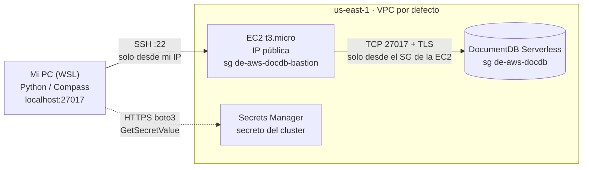

# Punto 3 - Amazon DocumentDB

## DocumentDB vs MongoDB

DocumentDB es una base de datos de documentos administrada por AWS que implementa la API de MongoDB (los mismos drivers, `pymongo`, Compass, `mongosh`), pero por debajo no es MongoDB: AWS construyó su propio motor sobre un almacenamiento distribuido parecido al de Aurora. Por eso una aplicación que ya funciona con MongoDB normalmente conecta sin cambios, pero hay diferencias que la pueden romper:

1. **No es 100 % compatible con todas las operaciones.** DocumentDB declara compatibilidad con una versión de la API de MongoDB y algunas cosas no están: JavaScript del lado del servidor (`$where`, `mapReduce`) y algunos operadores y etapas de agregación. Si la aplicación los usa, hay que reescribir esas consultas.
2. **Retryable writes no están soportadas.** Los drivers modernos de MongoDB las activan por defecto, así que hay que poner `retryWrites=false` en la cadena de conexión o las escrituras fallan. Lo tuve que agregar en la URI.
3. **Red y seguridad.** MongoDB (o Atlas) se puede exponer a internet; DocumentDB solo vive dentro de una VPC y viene con TLS obligatorio usando el certificado de AWS. Una app que antes se conectaba directo desde fuera necesita estar en la VPC, un túnel o una VPN, y el archivo `global-bundle.pem`.
4. **Arquitectura y escalado distintos.** En MongoDB cada miembro del replica set tiene su propia copia de los datos y se escala horizontal con sharding. En DocumentDB las réplicas comparten el mismo volumen de almacenamiento y los clusters normales no hacen sharding (para eso existen los Elastic Clusters, que son otro producto). Las lecturas en réplicas pueden tener un pequeño retraso, y cosas como los change streams hay que habilitarlas por colección.
5. **Cobro.** MongoDB autogestionado se paga como servidor; DocumentDB cobra cómputo, almacenamiento, operaciones de I/O y backup por separado.

## Aprovisionada vs Serverless

| | Aprovisionada `db.t3.medium` | Serverless 0.5–1 DCU |
|---|---|---|
| Memoria | 4 GiB fijos | 1 DCU ≈ 2 GiB, empieza en 0.5 DCU |
| Cobro | por hora de instancia encendida (por segundo, mínimo 10 min) | por DCU-hora consumida, por segundo |
| Precio us-east-1 | ≈ $0.078/h (precio de lista, confirmar en la calculadora) | $0.0822 por DCU-hora (Standard) → 0.5 DCU = **$0.0411/h** |
| Escala a cero | no | no, el mínimo es 0.5 DCU |
| Motor | 3.6, 4.0, 5.0 | solo 5.0 |

Para esta práctica (unas 2 horas, carga mínima) **sale más barato Serverless con mínimo de 0.5 DCU**: casi la mitad por hora que la instancia aprovisionada más pequeña, y la carga de 12 documentos no lo hace subir de 0.5–1 DCU. Por eso `crear.sh` usa `db.serverless` con `MinCapacity=0.5, MaxCapacity=1` (el máximo en 1 es un techo de gasto).

La única excepción: si la cuenta nunca ha usado DocumentDB, AWS da una prueba gratis de 30 días con 750 horas de `db.t3.medium`, 30 millones de I/O y 5 GB de almacenamiento. En ese caso la aprovisionada t3.medium costaría $0 y sería la opción más barata. La prueba no aplica a Serverless.

## Cómo me conecté (diagrama)



- DocumentDB no tiene endpoint público, solo responde dentro de la VPC.
- La EC2 está en una subred pública de la misma VPC, con IP pública. Su grupo de seguridad solo acepta SSH desde mi rango de red (`/24`, ver la nota de abajo).
- El grupo de seguridad de DocumentDB solo acepta el puerto 27017 desde el grupo de seguridad de la EC2, no desde ningún CIDR.
- El túnel `ssh -L 27017:<endpoint-cluster>:27017` hace que lo que entra a `localhost:27017` en mi PC salga desde la EC2 hacia el cluster.
- TLS: DocumentDB lo exige. Se descarga `global-bundle.pem` (la CA de AWS) y se pasa como `tlsCAFile`. Como me conecto a `localhost` y el certificado es del endpoint real, hay que poner `tlsAllowInvalidHostnames=true` (la conexión sigue cifrada y la CA sí se valida).
- `directConnection=true` porque por el túnel solo se ve un nodo y el driver no debe intentar descubrir el resto del replica set.

## Contraseña con Secrets Manager

El cluster se crea con `--manage-master-user-password`, así DocumentDB genera la contraseña y la guarda en un secreto que él mismo administra. En el código no hay contraseña: `documentdb_crud.py` le pide a DocumentDB el ARN del secreto (`MasterUserSecret.SecretArn`) y luego hace `GetSecretValue`. Para Compass la copio de la consola de Secrets Manager en el momento y no queda en ningún archivo ni captura.

## Cómo reproducirlo

```bash
pip install -r ../requirements.txt
bash crear.sh
# en otra terminal, dejar abierto el túnel que imprime el script:
ssh -i docdb-key.pem -N -L 27017:<endpoint>:27017 ec2-user@<ip-ec2>
python documentdb_crud.py
bash eliminar.sh
```

**Compass:** nueva conexión → URI `mongodb://docdbadmin@localhost:27017/?tls=true&tlsAllowInvalidHostnames=true&directConnection=true&retryWrites=false`, en la pestaña de autenticación la contraseña, y en TLS/SSL seleccionar `global-bundle.pem` como CA. Ahí se ve la base `tienda` con la colección `productos`.

## Consultas que hace el programa

Base `tienda`, colección `productos`, 12 documentos (datos inventados para la práctica).

1. **Filtro:** productos de periféricos o audio, con stock y precio menor a 200.000.
2. **Ordenación:** los 5 productos más caros, por precio descendente.
3. **Agregación:** por categoría, cuántos productos hay, precio promedio y valor del inventario (precio × stock), ordenado por valor de inventario.

La salida real se guarda en `../evidencias/p3/resultados.txt`.

## Costos

| Componente | Por hora | Práctica (~2 h) |
|---|---|---|
| DocumentDB Serverless 0.5 DCU ($0.0822/DCU-h) | $0.041 (hasta $0.082 si sube a 1 DCU) | $0.08–0.16 |
| Almacenamiento e I/O (unos KB, $0.20 por millón de I/O) | ~$0 | ~$0 |
| Secreto del cluster ($0.40/mes) | $0.0005 | $0.001 |
| EC2 t3.micro del túnel | $0.0104 | $0.021 |
| IPv4 pública de la EC2 | $0.005 | $0.010 |
| Disco gp3 8 GB de la EC2 | $0.0009 | $0.002 |
| **Total** | **≈ $0.058** | **≈ $0.11–0.20** |

La EC2 del túnel agrega unos $0.016 por hora (instancia + IPv4 + disco), alrededor de $0.03 en la práctica. Comparado con DocumentDB es poco, pero se cobra todo el tiempo que esté encendida, aunque el túnel esté cerrado. El backup de 1 día no cuesta extra porque no supera el tamaño del cluster.

## Lo que pasó en la práctica

- **Plan gratuito de AWS:** el primer `crear.sh` falló en `create-db-cluster` con `FreeTierRestrictionError`: con una cuenta en plan gratuito solo se permite crear clusters `aurora-postgresql`. No dependía del script ni de la red: hubo que pasar la cuenta a plan de pago (los créditos siguen disponibles). Antes de repetir se borraron a mano los restos de la corrida fallida (EC2, grupos de seguridad, llave y grupo de subredes).
- **La IP de salida cambia:** el túnel SSH dio `Connection timed out` aunque el grupo de seguridad tenía la regla. La regla estaba hecha con la IP pública del momento (`/32`, 38.9.221.136), pero mi proveedor rota la dirección de salida dentro del mismo rango (también apareció la .182). Se diagnosticó comparando `checkip.amazonaws.com` con la regla del grupo y probando el puerto 22 con `/dev/tcp`. Solución: autorizar el rango `/24` y dejar el script con `/24`, derivado de la IP actual.
- **Compass:** la URI de conexión va en la aplicación de MongoDB Compass (campo *URI*), no en la terminal. El aviso "end-of-life MongoDB" que muestra Compass es solo informativo y no impidió la conexión.
- **Tiempos medidos:** crear cluster, instancia y EC2: 5 min 32 s. Eliminar todo: 13 min 37 s (borrar el cluster es lo lento).

## Evidencias

En `../evidencias/p3/`: cluster e instancia disponibles en la consola, túnel abierto, conexión en Compass con la colección, salida de `documentdb_crud.py` y salida de `eliminar.sh` (cluster, snapshot y EC2 eliminados).
