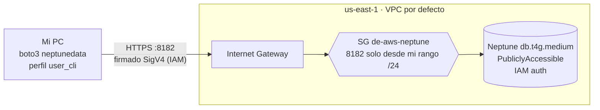
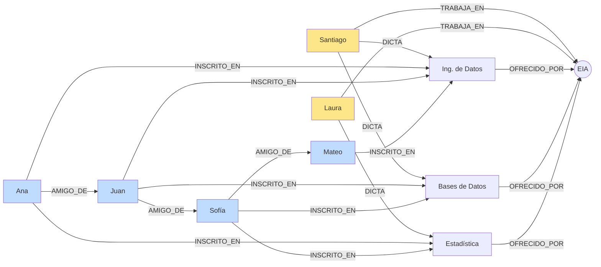

# Punto 4 - Amazon Neptune

## Neptune vs Neo4j

| | Neptune | Neo4j |
|---|---|---|
| Qué es | servicio administrado de AWS, sin servidor que mantener | motor de grafos que se instala (Community/Enterprise) o se usa en la nube con AuraDB |
| Modelos de datos | grafo de propiedades (nodos y aristas con atributos) **y** RDF (tripletas sujeto-predicado-objeto) en el mismo servicio | solo grafo de propiedades |
| Lenguajes | Gremlin, openCypher y SPARQL (este último para RDF) | Cypher (el original, más completo; openCypher es el estándar abierto que salió de él) |
| Herramientas | consola de AWS, `aws neptunedata`, cliente `neptunedata` de boto3, notebooks Jupyter de Neptune Workbench, Graph Explorer, bulk loader desde S3 | Neo4j Browser, Bloom, Desktop, Cypher Shell, librería APOC y Graph Data Science |
| Acceso | dentro de una VPC (o endpoint público con IAM desde la versión 1.4.6) | puerto 7687 (Bolt) donde uno lo exponga |
| Autenticación | IAM (firma SigV4) opcional; sin usuario/contraseña de base de datos | usuario y contraseña |

En la práctica, las consultas Cypher que hicimos en Neo4j en la actividad NoSQL funcionan casi igual en Neptune con openCypher, aunque Neptune no soporta todas las funciones (por ejemplo APOC no existe) y algunas cosas de Cypher no están.

## Aprovisionada vs Serverless

Ambas están disponibles. Se eligió **aprovisionada `db.t4g.medium`**:

- Serverless se cobra por NCU-hora y su mínimo es 1 NCU, que no baja a cero. Con la tarifa reportada para us-east-1 ($0.1098 por NCU-hora, confirmar en la calculadora) el mínimo ya cuesta unos $0.11/h.
- La `db.t4g.medium` es la instancia más pequeña de Neptune, con 4 GiB, y cuesta alrededor de $0.073/h (precio de lista, confirmar). Para un grafo de 10 nodos sobra.
- Además, si la cuenta es nueva en Neptune, la prueba gratis de 30 días cubre 750 horas de `db.t3.medium` o `db.t4g.medium`, 10 millones de I/O, 1 GB de almacenamiento y 1 GB de backup, así que el cómputo sale en $0.

Serverless tendría sentido con una carga que va y viene mucho; para un taller de un par de horas la instancia fija es más barata.

## Cómo consultar Neptune desde local

Hay dos opciones:

**A. Túnel SSH por una EC2** (como en DocumentDB): Neptune queda privado en la VPC, una EC2 con IP pública hace de puente y `ssh -L 8182:<endpoint>:8182` lo trae a `localhost:8182`. Necesita la EC2, su IPv4 pública, la llave SSH y un SG que deje pasar el 8182 desde la EC2. Como el certificado es del endpoint real hay que relajar la validación del nombre del host en el cliente.

**B. Endpoint público de Neptune** (la que se usó): desde la versión 1.4.6 del motor, una instancia se puede crear con `--publicly-accessible`. Requisitos: autenticación IAM activada en el cluster (es obligatoria para el endpoint público), la instancia en subredes públicas y un SG que deje entrar al 8182. No hay EC2 de por medio.

| | Túnel EC2 | Endpoint público |
|---|---|---|
| Recursos extra | EC2 + IPv4 + llave SSH | ninguno |
| Seguridad | Neptune nunca expuesto; SSH limitado a mi IP | expuesto a internet pero el SG solo deja mi IP y cada petición va firmada con IAM |
| Certificado | hay que ignorar el hostname | se valida normal |
| Costo extra | ≈ $0.016/h | $0 |

### Documentación de la opción elegida (endpoint público)

- **VPC:** la VPC por defecto de us-east-1, con su grupo de subredes `de-aws-neptune` formado por todas las subredes por defecto. Esas subredes son públicas.
- **Rutas:** las tablas de rutas de las subredes por defecto tienen `0.0.0.0/0 → Internet Gateway` (además de la ruta local de la VPC). Por eso una instancia con `PubliclyAccessible` recibe una dirección que resuelve desde internet.
- **Grupo de seguridad `de-aws-neptune`:** entrada solo TCP 8182 desde mi rango de red `/24` (el script lo deriva de `checkip.amazonaws.com`). Se usa `/24` y no `/32` porque mi proveedor cambia la IP de salida entre conexiones dentro del mismo rango (lo aprendido con el túnel del punto 3). La regla sigue sin ser pública: solo ese rango puede llegar al puerto 8182, y además se necesita una firma IAM.
- **Autenticación:** IAM. No existe contraseña. `user_cli` tiene `neptune-db:ReadDataViaQuery`, `WriteDataViaQuery`, `DeleteDataViaQuery` y `GetEngineStatus`. El cliente `neptunedata` de boto3 y `aws neptunedata` firman cada petición con SigV4 usando las llaves del perfil; sin esa firma Neptune responde 403.

**¿Es necesario el proceso con EC2?** No. Antes era la forma típica porque Neptune solo vivía en la VPC, pero con el endpoint público y autenticación IAM ya no hace falta. **Otras maneras:** AWS Client VPN o una VPN sitio a sitio hacia la VPC, Session Manager de Systems Manager con reenvío de puerto (sin abrir el 22 ni usar llaves, aunque sigue necesitando una instancia), Neptune Workbench (notebooks que AWS crea dentro de la VPC), o correr el código dentro de AWS (Lambda o EC2 en la VPC).

### Arquitectura de acceso



## Modelo del grafo



- **Vértices (10):** `Universidad` (1), `Profesor` (2), `Curso` (3, con `creditos`), `Estudiante` (4, con `semestre`).
- **Relaciones (18):** `TRABAJA_EN` (2), `OFRECIDO_POR` (3), `DICTA` (3), `INSCRITO_EN` (7, con propiedad `nota`), `AMIGO_DE` (3).
- Datos inventados para la práctica.

## Consultas (openCypher desde Python)

1. **Compañeros de clase de Ana:** recorre Estudiante → Curso ← Estudiante y devuelve con quién comparte cursos y cuáles. Responde "¿con quién podría estudiar Ana?".
2. **Estudiantes por profesor y nota promedio:** recorre Profesor → Curso ← Estudiante, cuenta estudiantes distintos y promedia la nota guardada en la relación `INSCRITO_EN`.
3. **Amigos de amigos de Ana:** dos saltos por `AMIGO_DE` excluyendo a Ana y a sus amigos directos. Es la típica consulta de recomendación que en SQL necesitaría varios self-joins.

```bash
bash crear.sh
AWS_PROFILE=user_cli python grafo_neptune.py
bash eliminar.sh
```

## Costos

| Componente | Precio | Práctica (~2 h) |
|---|---|---|
| Instancia db.t4g.medium | ≈ $0.073/h (confirmar) | ≈ $0.15 (o $0 con la prueba gratis) |
| Almacenamiento | $0.10 por GB-mes, el grafo pesa KB | ~$0 |
| I/O | $0.20 por millón de peticiones | ~$0 |
| Backup de 1 día | gratis hasta el tamaño del cluster | $0 |
| EC2 | no se usa (endpoint público) | $0 |

- **Cómputo y almacenamiento:** el cómputo es por hora de instancia encendida; el almacenamiento por GB-mes de lo que ocupe el volumen del cluster, más las operaciones de I/O.
- **¿El método de conexión añade una EC2?** No, con el endpoint público no hay EC2. Con el túnel se sumaría ≈ $0.016/h.
- **Qué se sigue cobrando sin consultas:** la instancia completa (se cobra por estar encendida, aunque no reciba nada), el almacenamiento del volumen y, si existieran, snapshots manuales o el backup que supere el tamaño del cluster. Por eso se borra todo con `--skip-final-snapshot`.

## Tiempos medidos

Crear el cluster y la instancia: 11 min 29 s. Eliminar: 9 min 57 s. Neptune es de los servicios que más tardan en quedar disponibles, por eso conviene dejar la instancia encendida solo lo que dura la prueba.

## Evidencias

En `../evidencias/p4/`: cluster con "IAM DB authentication: enabled" y la instancia "Publicly accessible", reglas del SG, salida de `get-engine-status`, salida de `grafo_neptune.py` y salida de `eliminar.sh`.
